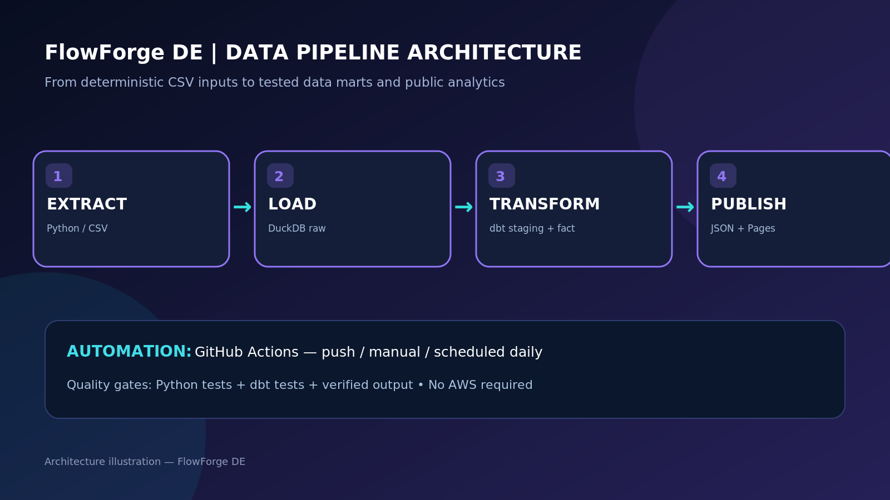

# ✦ FlowForge DE

**Automated Data Engineering Pipeline with Python, dbt, DuckDB, GitHub Actions, and GitHub Pages.**

[Live dashboard](https://gino019.github.io/automated-data-engineering-project/) · [GitHub Actions](https://github.com/Gino019/automated-data-engineering-project/actions) · [Medium article (publish to obtain URL)](docs/MEDIUM_ARTICLE_EN.md)

> This educational project uses **synthetic data only**, not real customer transactions. It runs without AWS or paid cloud infrastructure. The included dashboard's committed JSON is a *preview* until replaced by a successful CI-generated dbt export.

## What it demonstrates

1. **Extract** 3,200 deterministic synthetic sales orders, 260 customers and 48 products with Python.
2. **Load** three CSV extracts into the `raw` schema in DuckDB.
3. **Transform** the data with dbt staging models, a completed-orders fact table, and a monthly sales cube.
4. **Test** source uniqueness, required fields, relationships and accepted statuses using dbt + Python tests.
5. **Publish** privacy-safe, aggregated JSON and an interactive dashboard to GitHub Pages.
6. **Orchestrate** on pushes, manual dispatch, and a daily UTC schedule using GitHub Actions.

### Architecture



`CSV extract → DuckDB raw → dbt staging → dbt facts/mart → validated JSON → GitHub Pages`

## Run the complete pipeline locally

Requirements: Python 3.11 and a network connection to install Python packages.

```bash
python -m venv .venv
# Windows PowerShell: .venv\Scripts\Activate.ps1
# Linux/macOS: source .venv/bin/activate
pip install -r requirements.txt
python -m pytest tests -q
python scripts/generate_data.py
python scripts/ingest.py
dbt build --profiles-dir . --project-dir .
python scripts/export_dashboard.py
python scripts/validate_artifact.py
python -m http.server 8080 --directory site
```

Open http://localhost:8080. Do not open the HTML via `file://`; its JSON fetch needs a server.

**Preview without installing dbt:**

```bash
python -m scripts.bootstrap_preview
python -m http.server 8080 --directory site
```

This provides a deterministic, locally generated *preview*. It does not replace a successful dbt run for proof of the transformation pipeline.

## Deploy with GitHub Actions

The included workflow `.github/workflows/pipeline.yml` runs source generation, Python tests, DuckDB ingestion, `dbt build` (models and tests), aggregate JSON export, validation, Pages artifact upload, and Pages deployment. It also uploads `run_results.json`, `manifest.json`, and the aggregate JSON as an audit artifact.

**One-time GitHub configuration:** open [Settings → Pages](https://github.com/Gino019/automated-data-engineering-project/settings/pages), then set **Build and deployment → Source → GitHub Actions**. Push to `main` or use **Actions → FlowForge DE — ELT, Tests & Pages → Run workflow**. Enable Actions if asked. In a successful run both `pipeline` and `deploy` jobs are green.

**Scheduled runs:** GitHub Actions may delay or disable scheduled executions. Each run regenerates the *same deterministic synthetic dataset*, so a new run is not a real-time ingestion of live events.

## Data models

| Layer | Model | Purpose |
|---|---|---|
| Source | `raw.orders`, `raw.customers`, `raw.products` | Ingested, unmodified synthetic extracts |
| Staging | `stg_orders`, `stg_customers`, `stg_products` | Consistent types, field names and statuses |
| Fact | `fct_completed_orders` | Completed purchases, revenue, product costs and profit |
| Mart | `mart_sales_cube` | Per month × region × category aggregates |
| Consumption | `site/data/metrics.json` | Public aggregate-only dashboard dataset |

`analytics_staging` and `analytics_marts` are generated by dbt's schema naming convention (with `schema: analytics` in profiles).

## Privacy, caveats and verification

The records and dashboard are synthetic. The public JSON includes only pre-aggregated metrics, not customer identifiers. Data quality includes dbt generic tests and a singular non-negative values test. `dbt build` halts the pipeline if tests fail. The no-dependency preview is **not** proof of successful GitHub Actions or deployment; obtain that evidence from the actual [Actions run](https://github.com/Gino019/automated-data-engineering-project/actions).

The charts use Chart.js served by a public CDN. A network connection is needed to render charts; the numerical data table remains available without it.

## Documentation

- [`docs/MEDIUM_ARTICLE_EN.md`](docs/MEDIUM_ARTICLE_EN.md) — publish-ready English article with image placements and code excerpts
- [`docs/VIDEO_SCRIPT_ES.md`](docs/VIDEO_SCRIPT_ES.md) — under-5-minute video script
- [`docs/PUBLISHING_GUIDE_ES.md`](docs/PUBLISHING_GUIDE_ES.md) — GitHub Pages, Medium, video and ZIP hand-in checklist
- [`submission/links_template.txt`](submission/links_template.txt) — public URL template

## References

- [dbt: DuckDB setup](https://docs.getdbt.com/docs/local/connect-data-platform/duckdb-setup)
- [GitHub Pages: custom workflows](https://docs.github.com/en/pages/getting-started-with-github-pages/using-custom-workflows-with-github-pages)
- [DuckDB documentation](https://duckdb.org/docs/)

MIT License. Built for a practical data engineering learning assignment.
